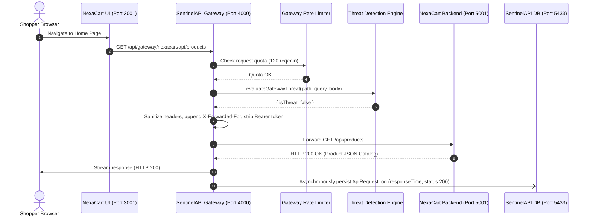
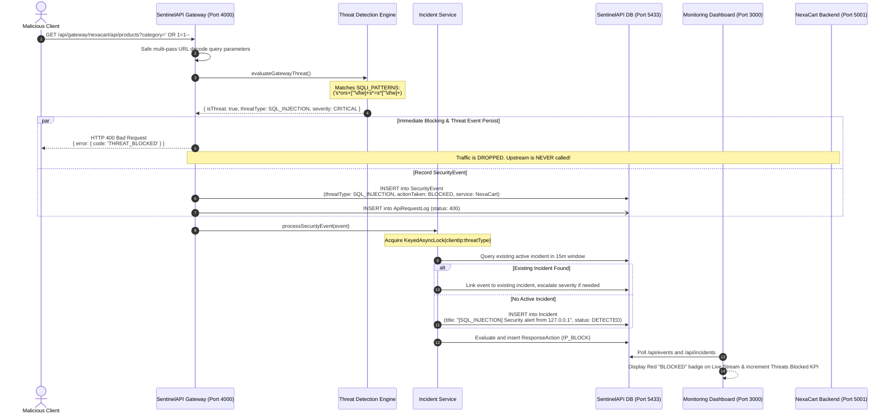
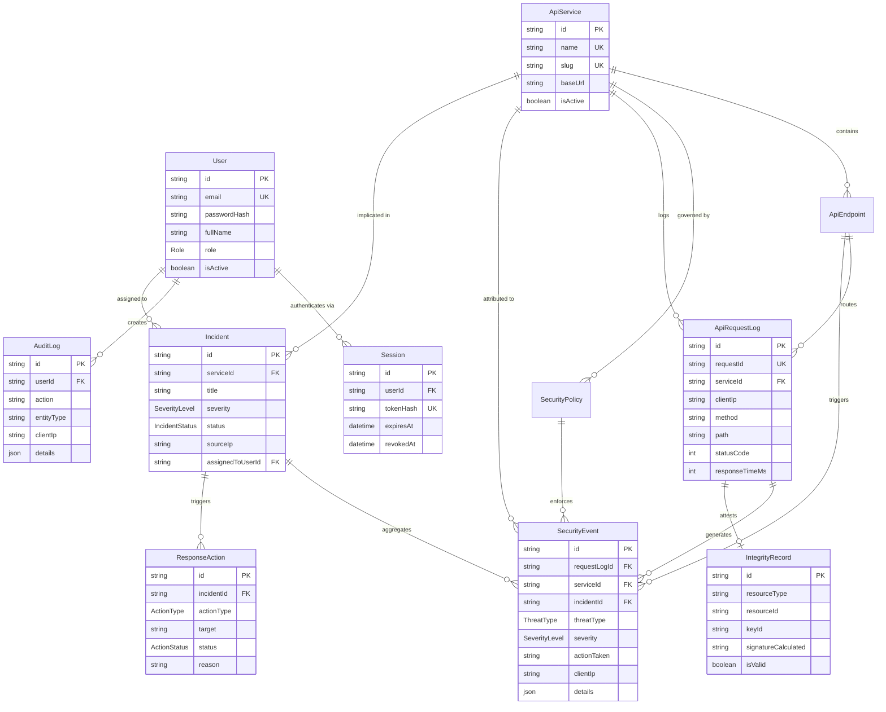

# SentinelAPI — System Architecture Specification

This document provides a comprehensive technical breakdown of the architecture, component interactions, request lifecycles, and data models of **SentinelAPI** and its demo-protected application, **NexaCart**.

---

## 1. Overall System Architecture

SentinelAPI is structured as an **inline security gateway** paired with an **out-of-band monitoring and response system**. It acts as an active reverse-proxy layer between external clients and upstream microservices.

```mermaid
graph TB
    subgraph ClientLayer["Clients & Users"]
        Customer["Online Shopper / Browser"]
        Analyst["Security Analyst / Admin"]
        Attacker["Adversary / Security Scanner"]
    end

    subgraph NexaCartApp["Protected Demo Application (NexaCart)"]
        StoreUI["NexaCart Storefront UI<br/>Next.js 16 (Port 3001)"]
        StoreAPI["NexaCart Catalog API<br/>Express + Prisma (Port 5001)"]
        StoreDB[("NexaCart Database<br/>PostgreSQL (Port 5434)")]
    end

    subgraph SentinelPlatform["SentinelAPI Security Platform"]
        SecurityUI["SentinelAPI Monitoring Console<br/>Next.js 16 (Port 3000)"]
        
        subgraph GatewayEngine["SentinelAPI Gateway & Backend (Port 4000)"]
            Router["Express Application Router"]
            GlobalLimiter["Global & Auth Rate Limiters"]
            GatewayLimiter["NexaCart Gateway Rate Limiter (120 req/m)"]
            ThreatEngine["Gateway Threat Inspector<br/>(SQLi & Path Traversal)"]
            ProxyForwarder["Reverse-Proxy Transport Forwarder<br/>(http/https Node module)"]
            IntegrityEngine["HMAC-SHA256 Integrity Service"]
            IncidentEngine["Incident Aggregation Service & Keyed Lock"]
            AuthModule["JWT & Argon2id Auth Module"]
        end

        SentinelDB[("SentinelAPI Database<br/>PostgreSQL (Port 5433)")]
    end

    %% Client Traffic
    Customer -->|Browse Store| StoreUI
    StoreUI -->|HTTP Gateway Requests| GatewayLimiter
    Attacker -->|Exploit Payloads / High Volume| GatewayLimiter
    Analyst -->|Admin Console / Audit| SecurityUI
    SecurityUI -->|Management REST API| Router

    %% Gateway Internal Flow
    GatewayLimiter -->|Pass| ThreatEngine
    GatewayLimiter -->|Exceeded (HTTP 429)| IncidentEngine
    ThreatEngine -->|Clean Traffic| ProxyForwarder
    ThreatEngine -->|Malicious Pattern (HTTP 400)| IncidentEngine
    ProxyForwarder -->|Forward Request| StoreAPI
    StoreAPI --> StoreDB

    %% Incident & Storage
    IncidentEngine --> SentinelDB
    IntegrityEngine --> SentinelDB
    AuthModule --> SentinelDB
    Router --> SentinelDB
```

---

## 2. Component Responsibilities & Boundaries

### 1. SentinelAPI Gateway Proxy (`backend/src/routes/gateway.route.ts`, `backend/src/services/gatewayService.ts`)
- **What it does**: Intercepts requests destined for protected microservices (specifically `/api/gateway/nexacart/*`).
- **Why it exists**: Provides an isolated, transparent proxy barrier so that security checks, URL sanitization, rate limits, and threat logging happen before traffic touches application business logic.
- **Input**: Inbound HTTP request (method, headers, query parameters, body).
- **Output**: Forwarded HTTP request to upstream (if clean) OR immediate **HTTP 400 Bad Request** / **HTTP 429 Too Many Requests** / **HTTP 504 Gateway Timeout**.
- **Calls**: `GatewayService.evaluateGatewayThreat()`, `IncidentService.processSecurityEvent()`, and native Node.js `http`/`https` client.

### 2. Threat Detection Engine (`backend/src/engine/threatDetector.ts`, `backend/src/services/gatewayService.ts`)
- **What it does**: Evaluates request parameters against deterministic security patterns:
  - SQL Injection (union selects, `' OR '1'='1'`, stacked queries, SQL comment tags).
  - Path Traversal (`../`, `..\`, `%2e%2e/`, `%2e%2e\`).
  - Brute Force Login: Sliding-window tracking of repeated failed login attempts.
- **Why it exists**: Immediately neutralizes deterministic web attack patterns without burdening upstream microservices.
- **Input**: Raw path, multi-pass URL-decoded path, parsed query object, and sanitized body.
- **Output**: `ThreatEvaluationResult` (`{ isThreat: boolean, threatType, severity, reason }`).
- **Calls**: `prisma.securityEvent.create()`, `IncidentService.processSecurityEvent()`.

### 3. Incident Aggregation Engine (`backend/src/services/incidentService.ts`)
- **What it does**: Correlates individual `SecurityEvent` records into consolidated `Incident` cases.
  - Groups events by `clientIp`, `serviceId`, and `threatType` within a 15-minute sliding window (`INCIDENT_AGGREGATION_WINDOW_MS = 900000`).
  - Automatically escalates incident severity (`LOW` &rarr; `MEDIUM` &rarr; `HIGH` &rarr; `CRITICAL`) if subsequent events carry higher severity.
  - Serializes concurrent events per `clientIp:threatType` using an in-memory `KeyedAsyncLock`.
- **Why it exists**: Solves "alert fatigue" by deduplicating repeated attacks from the same IP into a single actionable incident.
- **Input**: Newly created `SecurityEvent`.
- **Output**: Created or updated `Incident` record with linked security events and evaluated response actions.
- **Calls**: `prisma.incident.create()`, `prisma.incident.update()`, `evaluatePolicyResponseAction()`.

### 4. Cryptographic Data Integrity Engine (`backend/src/services/integrityService.ts`)
- **What it does**: Provides tamper-evident data protection using HMAC-SHA256 signatures.
  - Recursively canonicalizes JSON objects (lexicographical key sorting, whitespace elimination, rejection of unsupported types like circular references or BigInt).
  - Generates HMAC-SHA256 signatures using an active secret key registry.
  - Verifies signatures using constant-time comparison (`crypto.timingSafeEqual`) to prevent timing attacks.
- **Why it exists**: Ensures that critical transactional records (e.g., checkout totals, audit events) cannot be tampered with by clients or intermediaries.
- **Input**: Resource identifier, payload data, and signature.
- **Output**: Boolean verification result (`isValid: boolean`, `reason?: string`), database `IntegrityRecord`.
- **Calls**: Native Node.js `crypto` library, `prisma.integrityRecord`.

### 5. NexaCart Demo Storefront & Catalog API (`nexacart/`)
- **What it does**: Functions as a modern e-commerce application selling tech accessories.
  - Frontend (`port 3001`): Next.js storefront with a modern shopping interface.
  - Backend (`port 5001`): Express catalog API exposing `/api/products` and `/api/health`.
- **Why it exists**: Acts as the real-world client and upstream target to demonstrate SentinelAPI's transparent reverse-proxy protection.
- **Crucial Rule**: NexaCart has **no custom security logic**. It delegates all perimeter protection to SentinelAPI.

---

## 3. Request Flow & Lifecycles

### A. Sequence Diagram: Normal Clean Traffic



---

### B. Sequence Diagram: Detected Malicious Payload (SQL Injection)



---

## 4. Data Architecture & Entity Relationships

The SentinelAPI schema is defined in `backend/prisma/schema.prisma` and consists of 11 relational models:



### Important Schema Semantics
- **`SecurityEvent` vs `Incident`**: A `SecurityEvent` represents an atomic threat detection occurrence (e.g., one blocked HTTP request). An `Incident` represents a high-level case that aggregates multiple related events from the same source IP over time.
- **`actionTaken` Strings**:
  - `BLOCKED`: Request was dropped before forwarding (used by Gateway Threat Inspector and unauthorized route guards).
  - `THROTTLED`: Request was rejected due to rate limits (HTTP 429).
  - `FLAGGED`: Suspicious payload or HMAC mismatch detected on native monitoring routes.
  - `LOGGED`: Non-blocking telemetry or repeated login failure tracking.
- **Incident Status Lifecycle**:
  `DETECTED` &rarr; `INVESTIGATING` &rarr; `MITIGATED` / `RESOLVED` / `FALSE_POSITIVE` (re-opening to `INVESTIGATING` supported).

---

## 5. Security Controls & Technical Enforcement

| Security Control | Implementation Location | Trigger Condition | Response Behavior | Verification Test |
| :--- | :--- | :--- | :--- | :--- |
| **SQL Injection Gateway Guard** | `backend/src/services/gatewayService.ts` (`evaluateGatewayThreat`) | Regex match against union selects, quotes, tautologies (`OR 1=1`), or comments | Returns **HTTP 400** with `THREAT_BLOCKED`; request is never forwarded to upstream | `backend/tests/gateway.test.ts` |
| **Path Traversal Gateway Guard** | `backend/src/services/gatewayService.ts` (`evaluateGatewayThreat`) | Regex match against directory traversal characters (`../`, `..\`, `%2e%2e/`) | Returns **HTTP 400** with `THREAT_BLOCKED`; request is never forwarded to upstream | `backend/tests/gateway.test.ts` |
| **Gateway Rate Limiting** | `backend/src/middleware/rateLimiter.ts` (`nexacartGatewayRateLimiter`) | >120 requests in 60 seconds on `/api/gateway/nexacart/*` | Returns **HTTP 429** `TOO_MANY_REQUESTS`; logs `RATE_LIMIT_EXCEEDED` event attributed to NexaCart | `frontend/src/lib/api.test.ts` |
| **Authentication Rate Limiting** | `backend/src/middleware/rateLimiter.ts` (`authRateLimiter`) | >10 attempts in 60 seconds on `/api/auth/login` | Returns **HTTP 429** `TOO_MANY_REQUESTS`; protects against brute force attacks | `backend/tests/auth.test.ts` |
| **Brute Force Detection** | `backend/src/engine/threatDetector.ts` (`recordFailedLogin`) | >=5 failed logins within 5 minutes from same IP | Creates `UNAUTHORIZED_ACCESS` event with `HIGH` severity; creates/updates incident | `backend/tests/auth.test.ts` |
| **HMAC Data Integrity** | `backend/src/services/integrityService.ts` (`verifyHmacSignature`) | Mismatch between calculated HMAC-SHA256 and stored signature | Flags `HMAC_VERIFICATION_FAILED` event (`CRITICAL`), creates incident | `backend/tests/integrity.test.ts` |
| **Timing Attack Prevention** | `backend/src/services/integrityService.ts` (Line 161) | HMAC verification execution | Uses `crypto.timingSafeEqual` to avoid side-channel byte comparison timing leaks | `backend/tests/integrity.test.ts` |
| **Header Stripping & Forwarding** | `backend/src/services/gatewayService.ts` (`forwardRequest`) | Forwarding traffic to upstream | Strips hop-by-hop headers and internal `Authorization: Bearer` tokens; appends `X-Forwarded-For` | `backend/tests/gateway.test.ts` |
| **Upstream Failure & Timeout** | `backend/src/services/gatewayService.ts` (`forwardRequest`) | Upstream takes >8000ms or connection refused | Returns **HTTP 504 Gateway Timeout** or **HTTP 502 Bad Gateway** cleanly | `backend/tests/gateway.test.ts` |

---

## 6. Distinguishing Detection from Prevention

In application security architecture, it is essential to distinguish between **detection** and **prevention**:

1. **Gateway In-Flight Prevention (`actionTaken: 'BLOCKED'`)**:
   - Implemented in `GatewayService.inspectAndFilterRequest()`.
   - The request is evaluated synchronously before proxying.
   - If a threat is detected, the gateway immediately returns HTTP 400 and halts. **The payload never reaches the upstream backend.** This is true active prevention.
2. **Asynchronous Telemetry & Detection (`actionTaken: 'FLAGGED'`)**:
   - Implemented in `requestLogger.ts` for native SentinelAPI endpoints.
   - Evaluated after the response has been sent to monitor administrative traffic.
   - Merely recording an event with `actionTaken = 'FLAGGED'` does **not** stop the request from executing; it logs the anomaly for post-hoc analyst investigation.
3. **Simulated Response Actions**:
   - When an incident is created, `IncidentService.evaluatePolicyResponseAction()` creates a `ResponseAction` record (e.g., `IP_BLOCK`).
   - In this prototype, these records exist in PostgreSQL to track remediation workflows, but do not interact with low-level Linux kernel firewalls (`iptables`) or AWS Security Groups.
