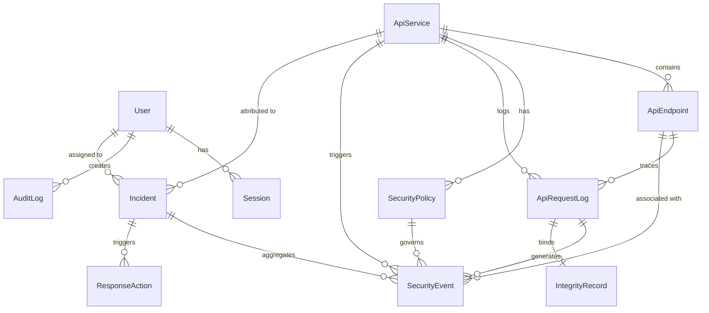

# SentinelAPI — Verified Project Facts & Source of Truth

> **Purpose of this document:**  
> This file is the single, canonical source of truth for the entire SentinelAPI codebase and its demo application NexaCart. Every statement, port number, endpoint path, database relationship, and behavior in this document has been directly verified against the active source code, configuration files, and test suites.

---

## 1. Executive Summary & Project Roles

- **SentinelAPI**: An intelligent, developer-centric API security gateway, threat detection, data integrity, and incident monitoring platform. It acts as an active reverse-proxy shield between external clients and upstream backend services.
- **NexaCart**: A separate, full-stack demo e-commerce store (storefront and catalog API) protected by SentinelAPI. NexaCart is intentionally kept clean of security logic; it serves to demonstrate real-world SentinelAPI protection under normal and adversarial conditions.
- **Project Status**: Academic and engineering prototype developed for a final-year engineering project and technical portfolio. It is fully functional locally across all implemented features, but not yet hardened for public cloud production.

---

## 2. Verified Technology Stack

| Layer | Component | Technology / Library | Version / Details |
| :--- | :--- | :--- | :--- |
| **Backend Runtime** | SentinelAPI Backend | Node.js, TypeScript (`tsx`) | Node 20+, TypeScript 7.0, Express 5.3 |
| **Database & ORM** | SentinelAPI DB | PostgreSQL 17 (Alpine), Prisma ORM | Port 5433, Prisma 7.10 with `@prisma/adapter-pg` |
| **Frontend Framework** | SentinelAPI Dashboard | Next.js 16 (App Router), React 19 | Tailwind CSS 4, Lucide icons, TypeScript 5 |
| **Authentication** | SentinelAPI Auth | JWT (`jsonwebtoken`), Argon2id (`@node-rs/argon2`) | Session tracking in DB, 1h JWT expiration |
| **Cryptography** | Data Integrity | Node.js native `crypto` | HMAC-SHA256, canonical JSON, timing-safe equal |
| **Rate Limiting** | Gateway & Auth Rate Limit | `express-rate-limit` | In-memory sliding window counters |
| **Demo Application** | NexaCart Backend | Express 4.21, TypeScript, Prisma 6.4 | Port 5001, dedicated PostgreSQL on Port 5434 |
| **Demo Storefront** | NexaCart Frontend | Next.js 16 (App Router), React 19 | Port 3001, custom modern CSS design system |
| **Containerization** | Local Infrastructure | Docker & Docker Compose v2 | Isolated Postgres containers per service |

---

## 3. Verified Network Architecture, Ports & URLs

| Service / Component | Protocol / Port | Local Base URL | Primary Role |
| :--- | :--- | :--- | :--- |
| **SentinelAPI Frontend** | HTTP / `3000` | `http://localhost:3000` | Security monitoring console, incidents, HMAC tool |
| **SentinelAPI Backend** | HTTP / `4000` | `http://127.0.0.1:4000` | Security gateway proxy, threat engine, REST API |
| **SentinelAPI PostgreSQL** | TCP / `5433` | `127.0.0.1:5433` | DB: `sentinelapi_db` (user: `sentinelapi_user`) |
| **NexaCart Frontend** | HTTP / `3001` | `http://localhost:3001` | Customer-facing e-commerce storefront |
| **NexaCart Backend** | HTTP / `5001` | `http://127.0.0.1:5001` | Upstream catalog API: `nexacart-backend` |
| **NexaCart PostgreSQL** | TCP / `5434` | `127.0.0.1:5434` | DB: `nexacart_db` (user: `nexacart_user`) |
| **ShadowShield (External)**| TCP / `5432` | `127.0.0.1:5432` | Independent legacy service (strictly untouched) |

### Crucial Gateway Routing Route:
- NexaCart Frontend communicates with NexaCart Backend **strictly via SentinelAPI Gateway**:
  - `NEXT_PUBLIC_NEXACART_API_URL=http://127.0.0.1:4000/api/gateway/nexacart`
  - SentinelAPI forwards clean traffic to upstream `http://127.0.0.1:5001`.
  - Malicious traffic is blocked on port `4000` before reaching port `5001`.

---

## 4. Key Endpoints & API Contracts

### A. SentinelAPI Gateway Proxy Routes
- `ALL /api/gateway/nexacart/*`
  - Rate limited by `nexacartGatewayRateLimiter` (120 req/min).
  - Inspects incoming path, query, and non-sensitive body for SQLi and Path Traversal.
  - If malicious: returns **HTTP 400** with `{ error: { code: 'THREAT_BLOCKED', threatType, requestId } }`.
  - If clean: forwards to `http://127.0.0.1:5001/*` preserving subpath, headers, and query parameters.
  - Upstream timeout: 8000ms (returns **HTTP 504** on timeout; **HTTP 502** if offline).

### B. SentinelAPI Core Endpoints
- `GET /api/health`: Public system health check `{ status: "ok", service: "sentinel-api-backend" }`.
- `POST /api/auth/login`: Public login (`email`, `password`) &rarr; returns JWT token and user info.
- `GET /api/auth/me`: Authenticated endpoint (Bearer token) &rarr; returns current user session.
- `POST /api/auth/logout`: Authenticated endpoint &rarr; revokes active DB session.
- `GET /api/services`: Authenticated list of registered protected services (`ApiService`).
- `GET /api/services/:id` or `/slug/:slug`: Service details by UUID or slug (`nexacart`).
- `GET /api/events`: Authenticated list of `SecurityEvent` records with query filters (`serviceId`, `threatType`, `actionTaken`, `severity`, `page`, `limit`).
- `GET /api/incidents`: Authenticated list of `Incident` records with query filters (`serviceId`, `status`, `severity`, `page`, `limit`).
- `GET /api/incidents/:id`: Single incident details with linked security events and response actions.
- `PATCH /api/incidents/:id/status`: Update incident status following strict lifecycle rules.
- `POST /api/incidents/:id/actions`: Execute manual or automated response actions (`IP_BLOCK`, `IP_THROTTLE`, etc.).
- `POST /api/integrity/sign`: Generate HMAC-SHA256 signature and save `IntegrityRecord` (Admin/Analyst only).
- `POST /api/integrity/verify`: Verify payload against stored signature; triggers `SecurityEvent` and incident if tampered.

### C. NexaCart Upstream Endpoints
- `GET /api/health`: Health status of NexaCart catalog service.
- `GET /api/products`: List all products (4 demo products seeded).
- `GET /api/products/:slug`: Get single product details.

---

## 5. Security Controls & Threat Detection Logic

### A. SQL Injection (SQLi) Detection & Blocking
- **Trigger Patterns**:
  - `(\b(union(\s+all)?\s+select)\b)`
  - `('\s*or\s+['"\d\w]+\s*=\s*['"\d\w]+)`
  - `(\b(or\s+1\s*=\s*1)\b)`
  - `(\b(or\s+'1'\s*=\s*'1')\b)`
  - `(;\s*(drop|delete|insert|update|alter|truncate)\s+[a-z_])`
  - `(--\s*$|#\s*$|\/\*.*?\*\/)`
- **Inspected Scope**: Request path, decoded path (up to 2 passes of URL decoding), query string, sanitized JSON body.
- **Action on Gateway**: **BLOCKED (HTTP 400)**. `SecurityEvent` created (`actionTaken: 'BLOCKED'`, `severity: CRITICAL`, `threatType: SQL_INJECTION`).
- **Incident Escalation**: Automatically groups or creates an Incident with CRITICAL severity.

### B. Path Traversal Detection & Blocking
- **Trigger Patterns**:
  - `(?:\.\.\/|\.\.\\)`
  - `%2e%2e(?:%2f|\/|%5c|\\)`
  - `\.\.(?:%2f|%5c)`
- **Inspected Scope**: Raw path, URL-decoded path, query parameters, request body.
- **Action on Gateway**: **BLOCKED (HTTP 400)**. `SecurityEvent` created (`actionTaken: 'BLOCKED'`, `severity: HIGH`, `threatType: PATH_TRAVERSAL`).
- **Incident Escalation**: Automatically groups or creates an Incident with HIGH severity.

### C. Rate Limiting (In-Memory Sliding Window)
- **Global Rate Limiter**: 100 requests / 60 seconds across native `/api/*` endpoints.
- **Auth Rate Limiter**: 10 login attempts / 60 seconds on `/api/auth/login`.
- **NexaCart Gateway Rate Limiter**: 120 requests / 60 seconds on `/api/gateway/nexacart/*`.
- **Behavior on Violation**: Returns **HTTP 429 Too Many Requests**. Records `SecurityEvent` with `threatType: RATE_LIMIT_EXCEEDED`, `actionTaken: 'THROTTLED'`, `severity: MEDIUM`, and explicitly links `serviceId` to NexaCart.
- **Limitation**: In-memory counters reset upon Node.js process restart and are single-process bound.

### D. Cryptographic Data Integrity (HMAC-SHA256)
- **Mechanism**:
  - Deterministic JSON canonicalization: object keys sorted lexicographically, whitespace stripped, arrays preserved, unsupported types rejected (`undefined`, `bigint`, symbols, circular references).
  - Key management: Multi-key registry supporting key rotation via `keyId` (default `sentinel-hmac-v1`).
  - Verification: `crypto.timingSafeEqual` prevents side-channel timing attacks.
  - On Verification Failure: Flags `SecurityEvent` (`threatType: HMAC_VERIFICATION_FAILED`, `severity: CRITICAL`, `actionTaken: 'FLAGGED'`) and triggers incident creation.

### E. Cooldown & Concurrency Controls
- **Event Cooldown Tracker**: In-memory map suppresses duplicate `SecurityEvent` creation for the same client IP and threat pattern within a 30-second window (`EVENT_COOLDOWN_MS=30000`).
- **Keyed Concurrency Lock (`KeyedAsyncLock`)**: Serializes concurrent event processing per `clientIp:threatType` to prevent race conditions from creating duplicate incident records.

---

## 6. Database Entity Architecture (Prisma)

SentinelAPI manages 11 interconnected relational models:

### Core Enums:
- `Role`: `ADMIN`, `SECURITY_ANALYST`, `API_CONSUMER`, `AUDITOR`
- `SeverityLevel`: `LOW`, `MEDIUM`, `HIGH`, `CRITICAL`
- `ThreatType`: `SQL_INJECTION`, `XSS`, `PATH_TRAVERSAL`, `RATE_LIMIT_EXCEEDED`, `HMAC_VERIFICATION_FAILED`, `MALFORMED_PAYLOAD`, `UNAUTHORIZED_ACCESS`
- `IncidentStatus`: `DETECTED`, `INVESTIGATING`, `MITIGATED`, `RESOLVED`, `FALSE_POSITIVE`
- `ActionType`: `IP_BLOCK`, `IP_THROTTLE`, `KEY_REVOCATION`, `NOTIFICATION_SENT`, `MANUAL_OVERRIDE`
- `ActionStatus`: `PENDING`, `APPLIED`, `EXPIRED`, `REVOKED`, `FAILED`

---

## 7. Verified Test Suites

| Suite Name | Command | File Path | Verified Coverage |
| :--- | :--- | :--- | :--- |
| **Authentication** | `npm run test:auth` | `backend/tests/auth.test.ts` | 10/10 scenarios passed (passwords hashed with Argon2id, JWT expiry, session revocation, RBAC) |
| **Frontend API** | `npm test` | `frontend/src/lib/api.test.ts` | 6/6 scenarios passed (service resolution, filters, error handling, throttled action contract) |
| **NexaCart Health** | `npm run test:health` | `nexacart/backend/tests/health.test.ts` | 3/3 scenarios passed (health 200, product catalog 200, 404 handler) |
| **Gateway Proxy** | `npm run test:gateway` | `backend/tests/gateway.test.ts` | Forwarding, SQLi rejection, traversal rejection, header sanitation |
| **Incidents** | `npm run test:incident` | `backend/tests/incident.test.ts` | Event grouping, severity escalation, lifecycle status transitions |
| **Monitoring** | `npm run test:monitoring`| `backend/tests/monitoring.test.ts` | Event filtering, pagination, service isolation |
| **Integrity** | `npm run test:integrity` | `backend/tests/integrity.test.ts` | Canonicalization, timing-safe equality, tampering detection |

---

## 8. Current Limitations & Honest Engineering Gaps

1. **In-Memory Rate Limiting**: The rate limit state is stored in memory (`Map`). Process restarts reset counters; counters are not synchronized across multiple Node.js instances (would require Redis).
2. **Deterministic Regex Threat Detection**: Threat detection relies on regex signatures. Highly obfuscated or zero-day SQLi/traversal payloads may evade simple pattern checks.
3. **Simulated Response Actions**: While the gateway directly drops malicious requests (HTTP 400), response actions triggered in the Incident management system (such as `IP_BLOCK` or `IP_THROTTLE`) are stored as database records with status `PENDING`/`APPLIED`, but do not dynamically reconfigure the operating system firewall (iptables/nftables) or cloud WAF.
4. **Single-Node Architecture**: Both services run as standalone Express servers intended for single-host or containerized demonstration.
5. **No Public HTTPS/TLS in Local Dev**: Services run over HTTP on `localhost`/`127.0.0.1`. In production, TLS termination at a reverse proxy (NGINX/Cloudflare) is mandatory.
